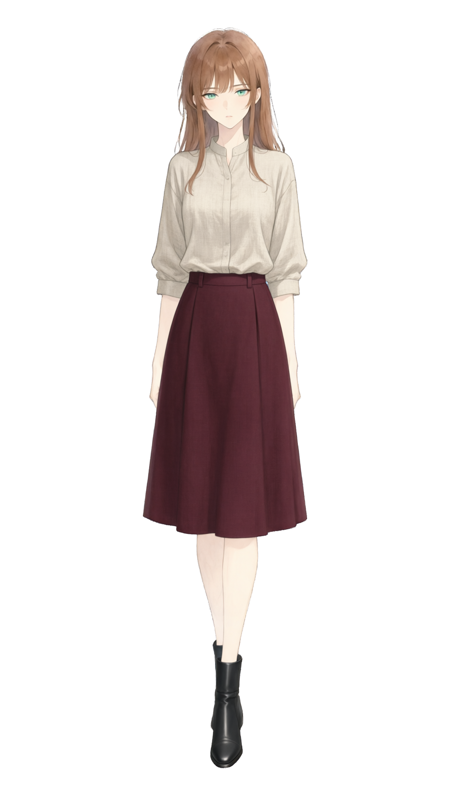
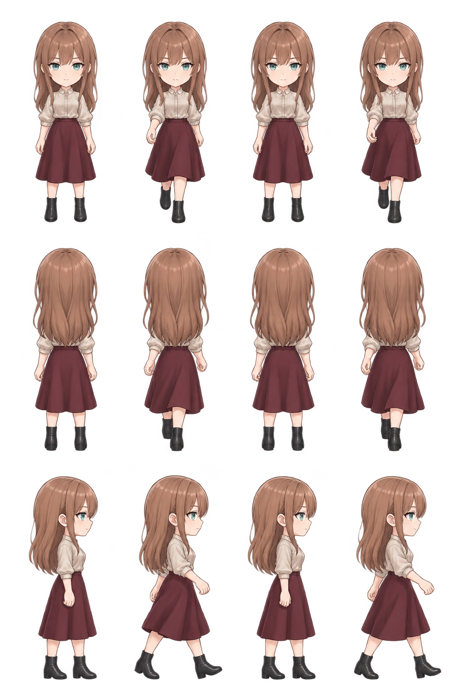

# GFX-07-01 — Evelyn G1 art-blocked handoff

**Not a completed sprite sheet. No validated frames, animation resource, moving Evelyn preview or owner approval is delivered.** `rejected_source.png` is retained solely as generation/rejection evidence. It must not be loaded as production art. The fallback is the precise import contract below. G1 remains open; Onoe remains the technical placeholder.

## Reference authority and identity

Baseline: `bezdredoff/RavenManor-Godot@832657cbbed2511a38485ae869b9b021484eb7c8` (merged #266, fetched 2026-11-16). At audit time GitHub returned no open PRs. Tracked filename/content search found no previous Evelyn chibi sheet or owner-reviewed chibi candidate; this does not claim to search private conversations or untracked owner files.

`data/raven/production/vn_character_catalog.json` explicitly reconfirms all 62 existing cast images, including 18 Evelyn images, as accepted VN art on 2026-11-02. That approval does not extend to map sprites. `docs/RELEASE_FINISH_PLAN_20261115_RU.md` bounds Agent D to one G1 walker; it supersedes the older broad tool bake-off for this delivery. `docs/assets/CHARACTER_PRODUCTION_BIBLE.md` is a working specification: its historical coat/vest proposal is not permission to change the accepted outfit.

| Reference | SHA-256 | Inspected evidence |
|---|---|---|
| `assets/raven/characters/evelyn/base_neutral.webp` | `d310b148ce1dc43e545d9c7e96a3c5eeac5b4e6339b7628335c49917758262fb` | Full body, face, bangs, blouse, skirt, boots |
| `assets/raven/characters/evelyn/investigate_wide.webp` | `22cd2538ec0fed55643ca95ddee1d4fe5e236b476035aa3371564e7bd70b8ec6` | Separate legs and both low-block-heel ankle boots, sleeve/collar detail |

Canonical visual contract: warm light-brown long loose hair, softly parted bangs and long cheek locks; teal-green eyes; ivory band-collar button blouse with loose sleeves and gathered cuffs; high-waisted burgundy A-line calf-length skirt; bare lower legs; black ankle boots with modest block heels. No coat, apron, jewelry, combat gear or supernatural additions. Preserve the skirt length while keeping two lower legs/boots readable through staggered gait. Target 3.5–4.5 heads, adult mildly-chibi proportions, illustrated anime rather than pixel-art styling. Back construction and exact profile hair silhouette are **inferred**, not approved turnarounds. Mirroring reverses the hair part and needs owner consent; if rejected, a separate left-facing row needs a revised contract before production.

## Visual comparison

Approved VN reference (unchanged):

Rejected correction, shown for comparison only:

The corrected design retains the blouse/skirt/boots palette but overshoots head size, repeats gait phases and has low-alpha background haze. It is not a production candidate. All twelve raw cells have `productionValidated: false` in `source_audit.json`.

## Provenance and bounded attempt

Two built-in `image_gen.imagegen` calls: one atlas attempt using the two approved repository references, followed by one correction referencing that output. `transparent_background=true` was requested both times. Tool model/version/seed are not exposed; deterministic regeneration of the illustrations is **not** claimed. No VN portraits were modified. No private UPDS art was imported. Retained correction SHA-256: `8241e8b214aa46f8f2b8b1f6b2697fe11645c378d9bc874c39f3037c5a42709a`.

Initial prompt requested a 4×3 transparent atlas, front/back/right, exact canonical outfit, four-head proportions, two separate legs and opposite stride phases. The first output stayed near VN proportions and repeated phases. The correction explicitly requested actual alpha, enlarged head/shortened limbs, opposite left/right forward phases, fixed cell baseline and unchanged outfit. It improved the chibi direction but failed the gait and proportion gates. No third attempt or unrelated variant batch was made. The initial source remains an uncommitted generation intermediate; the retained correction is the only art in this handoff.

Alpha inspection corrected the initial visual impression of an opaque backdrop: the files are RGBA. The correction has 887,371 exactly transparent pixels out of 1,572,864; 104,193 pixels have alpha 1–15. Colored haze is visible around the cutouts. A blanket alpha threshold could damage hair edges and is not an approved repair. Bounds above alpha 32 are **measurements only**, not extracted/validated silhouettes. Production pixels were never cleaned, cropped, resized or repainted by the audit script.

## Deterministic import-ready specification

`atlas_spec.json` is a **target contract**, not metadata certifying `rejected_source.png`. Its `runtimeAtlas` is null and `validatedFrames` is empty by design. A future artist must deliver a clean lossless RGBA PNG at 1024×1536, 256×512 cells, four columns and rows down/up/right-side. Four frames per row at proposed 6 FPS: neutral, left-forward, neutral, right-forward. Neutral is also idle; no additional idle/emote/combat pack. Each cell has pivot (128,480), crown around y32, 448px visible height (±2px) and lowest planted sole at y480 (±1px). Animated lifted boot may rise; planted contact must stay stable. Keep transparent padding and anatomy within its own cell. Frame regions are fixed, row-major; do not auto-trim at import.

Godot import: lossless, linear filtering, no mipmaps. Create `SpriteFrames` clips `down`, `up`, `side`; each contains four `AtlasTexture` regions `(column*256,row*512,256,512)`, loop=true, speed=6. A centered AnimatedSprite2D uses uniform scale `displayVisibleHeight/448` and position `(0,-224)*scale`; this maps local (128,480) to the actor root. Root is always the physical floor-contact point. Idle stops and selects frame 0 of the retained facing. Do not derive scale from the full 512px cell including padding.

Reuse `OnoeVisual.play_sprite_direction`: side when abs(x)>abs(y), otherwise down for positive y/up for negative y; zero retains facing, exact diagonal tie is vertical. Side right is native and left uses flip_h only after asymmetry approval. Keep the existing `get_sprite`, `face`, `set_idle`, `set_display_height`, `display_height` visual interface. For the isolated preview, subclass `onoe_segment_mover.gd` and override only `_ready` to assign a new visual to its existing `_visual` member; retain the parent's segment executor and signals. Do not edit the shared mover or duplicate route logic. Reduced motion selects neutral frame of current facing while preserving physical travel and arrival signals.

Reuse audit: freshly inspected `UPDS-godot@3deed628efd6c22bcd1717f7c545b7d3ca865781` recursive tree. `assets/characters/onoe/neutral.webp` blob `b7fabab776822ba906034713fd012fbdbde457fe` is VN art; the tree supplies no directional map walker. No donor art transfer. Raven `onoe_visual.gd` blob `b85fac3b7658de2224f39225a72be921535bc793` and `onoe_segment_mover.gd` blob `5c7a43ea6b99c4ad6681ca82303b7ac0422ee222` already supply the needed interface: **adapter/reuse**, not a new gameplay controller. No runtime code is changed in this blocked handoff.

## Exact owner QA / later isolated harness

Every item below is **NOT_RUN** for Evelyn. Passing source audit does not complete any item.

1. Compare front idle, moving side and back against both approved references: face, warm-brown hair, bangs/part, blouse collar/cuffs, burgundy calf-length skirt, boot height/heel and 3.5–4.5-head proportions. Approve inferred back/profile and mirrored hair part explicitly.
2. Scrub all twelve frames on light, dark and checker backgrounds. Reject haze, halos, clipped hair/boots, changing costume, merged/crossed extra limbs, disappearing far leg or nonalternating stride. Confirm two separate lower legs and boots in each frame, especially side neutral/passing frames.
3. Overlay all frames at pivot (128,480). Measure crown/height and planted sole tolerances. Play two full cycles of every direction; check body/foot jitter, alternating weight, loop seam and left flip. A fixed pivot alone does not prove absence of foot sliding.
4. Build the isolated visual subclass described above and inherit `scenes/raven/tests/first_floor_hall_movement_pilot.tscn`, overriding only its actor resource. Use the existing approved-source `RouteSession`/mover, not arbitrary tap-to-move. Test right→up→left→down turns, repeated start/stop and idle retention. Pause halfway through a leg: root XY/destination stay fixed, no arrival signal. Resume reaches the same endpoint exactly. Cancel finishes only the current authorized leg; queued replacement begins only at a safe anchor. No teleport.
5. Evaluate the **actual** approved first-floor PNG `a_detailed_top_down_isometric_game_map_illustratio.png` (SHA-256 `5e0edf97bd719fb1df95c7e9bea2f134d90adad0bc04d1771acc82a95a4d549a`) at 390×844 portrait, source-space actor visible height 62px and zoom 0.74 (45.88 screen px), then current Hall pilot zoom 0.9 (55.8px). Camera contract: upright body, uniformly scaled, root follows projected floor point; never apply floor compression to the body. Check face/leg readability, scale against doors/furniture and planted feet under movement at the existing 130 source px/s. Proposed 6 FPS is subject to stride/slip calibration.
6. Use the existing multi-room QA host after geometry approval for Hall→Corridor→Bedroom and reverse. Inspect feet at every sill, foreground split, stair edge and furniture crossing. Existing Hall pilot actor z=20 is diagnostic, not proof of correct foreground masks. Require screenshots/video of actor in front of and behind intended layers; if a mask hides the whole sprite or footpoint is wrong, record a map-owner blocker. Do not change map geometry/masks in the chibi PR.
7. Reduced motion: hold neutral direction frame while travelling the same root route; no bob/sway, same arrivals and cancellation. Pause/resume/restart must not reset the character to a prior anchor. Test desktop and real portrait phone; simulated viewport is not device acceptance.
8. Record exact atlas SHA, preview head SHA, screenshots/video, owner approval and remaining defects. Only a later explicitly approved integration PR may replace Onoe in gameplay. No auto-merge.

## Verification and Agent E handoff

Run `python assets/raven/chibi/evelyn/g1_candidate/audit_source.py --check` (Pillow). This checks reproducibility of the rejected-source measurements and fail-closed metadata only. It is not an animation test. `source_audit.json` records each measured raw cell bound; no frame meets the full art acceptance contract. Runtime movement, real-scale rendering, foreground masking, reduced motion and device tests are **NOT_RUN**, blocked by absence of a usable atlas. A Godot 4.7.2 executable was located/version-checked, but no Evelyn scene exists to test honestly.

Agent E was contacted in the existing QA chat under the user's coordination instruction. Shared test registration remains Agent E's scope. Until art is fixed there is no new Godot smoke to register; the local source-audit command above is available, with rejection semantics explicit. Do not convert its PASS into a G1 art gate PASS.

Blocker owner: character artist / owner art review. Needed next artifact: one corrected, aligned, truly transparent alternate-leg atlas meeting this specification, followed by the isolated mover preview and checklist above. No approved art, route, door, save, controller, production scene or shared test runner was changed. Removing this new directory and the unique change note rolls back the handoff; the owning shard can be reconciled separately.
