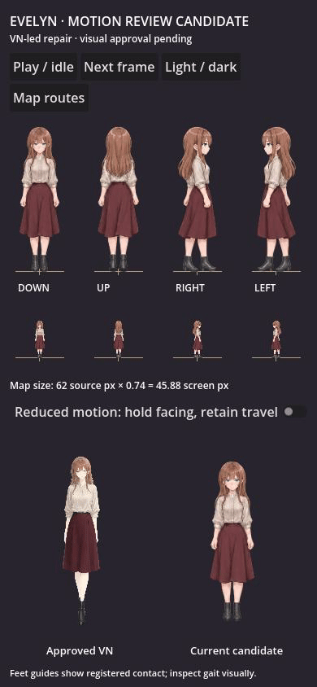
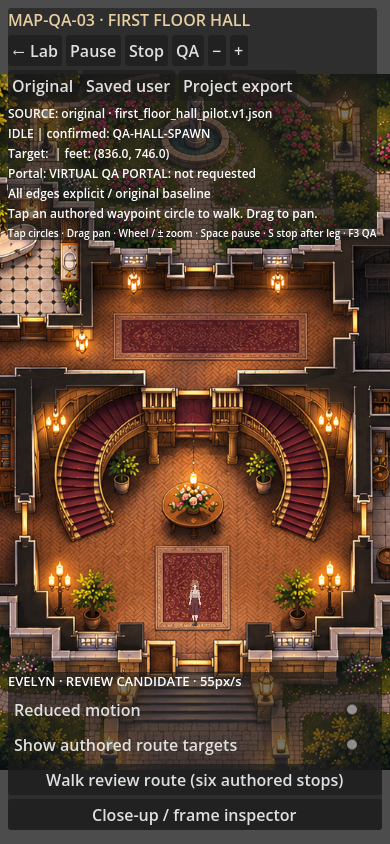

# Evelyn — selected design, repaired motion candidate

The owner selected the earlier design in chat ("i like it"), then explicitly requested repair. **Preserve that selected face, hair, outfit, palette and proportions.** This overrides the earlier proposed change to 3.5–4.5-head proportions for this candidate. Selection of the design is not approval of repaired motion, hair mirroring, device readability or production replacement.

## Review now

- F6 `res://scenes/raven/tests/evelyn_chibi_preview.tscn`: four facings, play/idle, single-frame inspection, light/dark backgrounds, reduced-motion hold, actual portrait map size and approved VN comparison.
- F6 `res://scenes/raven/tests/evelyn_chibi_map_preview.tscn`: existing first-floor Hall route scene with only the candidate visual substituted. Tap authored circles, Space/button pause/resume, S/Stop finishes the current leg, QA toggles diagnostics. Starts at the approved pilot's existing spawn, with 62px visible source height and 0.74 zoom. No production source, geometry, door, save or controller edits.





The Hall pilot is a flat approved map plus diagnostics, not a layered-foreground certification. Multi-room sill/foreground occlusion and real phone approval remain pending, with the original handoff checklist applicable. Physical door calibration is separately owned in PR #270. No merge or production replacement is authorized by selecting this design.

## Repaired atlas and integration contract

`evelyn_walk.png` is the retained built-in imagegen repair, unchanged after generation. Two focused edits were made after the owner's repair request: preserve the selected design and repair the sheet, then change the fourth-column leading foot specifically. Front/back now visibly reverse the leading boot instead of repeating it; side changes arm/leg staging. The front/back raised leg is a larger step than the opposing phase, and side leg overlap still needs subjective walk review. No claim of anatomically certified or slip-free motion is made from headless tests.

1024×1536 RGBA source; three rows down/up/right-side; four frames at 6 FPS. Neutral frames 0/2, opposed step poses 1/3. Idle = frame 0. Left uses side flip and reverses hair part; approve that explicitly. `frames.json` pins SHA-256, all twelve explicit regions and measured source pivots. The generated side pose crosses the nominal x768 boundary, so the side row uses cuts 0/256/512/**754**/1024. This split is inside the measured transparent gutter; no neighbour is sampled. Other rows use 0/256/512/768/1024. No implicit uniform-grid slicing is safe for this source; consume the supplied regions.

For each frame, the pivot is median head-center X and lowest alpha>128 sole boundary Y; visible height is measured from crown to that sole. The runtime applies uniform scale `requestedHeight/visibleHeight` and centered texture offset `(regionSize/2 - sourcePivot)*scale`. Mirrored X offset is negated. This registers the feet at the physical root and normalizes height; it does not modify atlas pixels, project the body, change path travel or prove planted-foot friction. Per-frame scales/pivots are intentional import metadata, not a single falsely claimed raw-cell pivot.

The raw generated alpha still has faint residue. `clean_alpha.gdshader` suppresses it at render time with `alpha *= smoothstep(0.05,0.15,alpha)`; this is an **essential import material**, not a claim that the raw PNG is a perfectly clean cutout. Its effect on fine hair edges was inspected on light/dark rendered captures and remains owner-reviewable. Keep this material when reusing the atlas. Pixel alpha above 0.15 is unchanged. Do not replace this with opaque black/white background extraction or transfer the raw sheet into a consumer that ignores the material.

`evelyn_actor.gd` overrides only the existing mover's `_ready` to install `evelyn_visual.gd`. It inherits real segment execution, position checks, arrival signals and pause behavior. The existing Onoe directional helper is reused. Reduced motion retains physical movement but holds frame 0 of the facing. No second route controller. The close-up controls are isolated Godot QA controls, not a new player UI. Current UPDS tree was rechecked at `3deed628efd6c22bcd1717f7c545b7d3ca865781`; donor/Raven blob evidence in the original handoff still applies.

## Reproduce validation

```text
python assets/raven/chibi/evelyn/g1_candidate/repair_v1/measure_frames.py --check
godot --headless --path . --script res://assets/raven/chibi/evelyn/g1_candidate/repair_v1/preview_smoke.gd
godot --headless --path . --script res://tests/raven/onoe_segment_movement_smoke.gd
python scripts/raven/tools/progress_shards.py
python scripts/raven/tools/build_production_dashboard.py --check
```

Python/Pillow only measures pixels; it does not edit them. Measurements reproduce explicit frame rectangles, source SHA, bounded silhouettes and source pivots. Godot smoke covers all 12 frames and both side flips, constant displayed height, sole registration, four turns, start/stop/idle, pause/resume, reduced motion and cancellation on the inherited real Hall route. Tests cannot approve identity, leg anatomy or foot sliding. Shared test registration remains Agent E's scope.

The handbook's mandatory raster-coverage gate requires provenance for both generated sheets and all three PNG captures. Five chibi-specific records and three recipes are registered in its existing source manifest, with official catalog/data regeneration. Two fixed count assertions change to 160/69 after Agent E coordination; no art acceptance or validation rule is weakened.

Captures are real Godot 4.7.2 Compatibility renderer output at 390×844. GIF is a 32-frame/24-FPS Godot Movie Maker recording encoded to a looping 12-FPS GIF with ffmpeg; the temporary AVI stays outside repository source. PNGs are direct viewport captures. Run a scene with `-- --capture=<path.png>` (close-up), `-- --light --capture=<path.png>` (light close-up), or `-- --capture-map=<path.png>` (map) to capture and exit.

## Provenance and remaining owner QA

Built-in `image_gen.imagegen`, transparent background requested. Edit target: original selected `../rejected_source.png`, then the first repair intermediate. Model/seed not exposed. No VN art was edited. No CLI API or external character assets used. Final prompts are recorded in `repair_prompts.txt`. Raw illustrations are not deterministically regenerable; layout/metadata/renderer are deterministic for the pinned file.

Inspect the GIF and live preview for exaggerated stepping, two distinct legs at every phase, stable skirt/hair and loop seams. Confirm selected proportions remain desirable in motion. Approve or reject the mirrored hair part. On the real device, review 45.88 screen-pixel height, route turns and UI overlap. Finally test layered foreground/sills in the integration owner's approved multi-room scene. These checks remain **HUMAN_PENDING**, and the candidate must stay isolated until approved. G1 full acceptance remains open.
