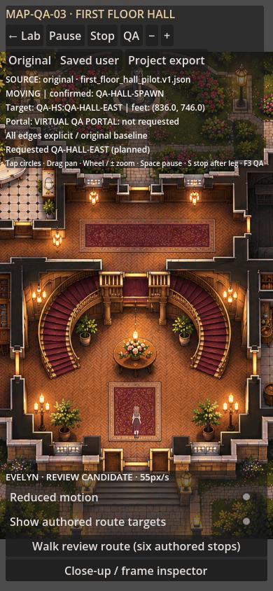
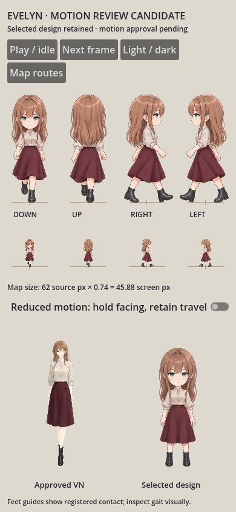

# Evelyn fix-pass candidate — current review entry point

**Approved Evelyn visual and motion (2026-11-17):** after merging #274, the owner inspected the Godot preview and explicitly approved this exact chibi design/animation for Raven Manor. No redesign. This does **not** certify normal New Game integration, physical-phone performance or layered room occlusion; production release gates are still pending.

This directory name is retained for existing preview paths. Its atlas, metadata, scripts and captures now supersede PR #269's repair. The original rejected_source.png, source_audit.json, atlas_spec.json and parent HANDOFF.md are historical rejection evidence, not the current atlas specification. Old repair pixels remain in Git history.

## Audit and authority

Baseline: fresh origin/main `2631c7a9f87d146f02244894b64dc5899e462c5a`, the actual merge of #269. Queried open/closed GitHub PR history, including #241/#243/#244 (Onoe adapter/Hall/diagnostics), #238 (route session), #257/#260/#268 (navigation/gameplay), #269 (Evelyn) and #270 (draft HC/CB physical doors). No overlapping open PR was found. #269's final head was 076d0433547e42c6109d6682c0dea548b9074fdc. Its green CI explicitly coexisted with CHANGES NEEDED: high asymmetric knees, side-leg overlap and apparent slip. The old GIF predated its last cadence change.

Approved identity authority: `assets/raven/characters/evelyn/base_neutral.webp` and the accepted VN records in the art handbook. Long warm chestnut hair, restrained green/teal eyes, ivory band-collar linen blouse, deep wine midi skirt and black ankle boots guide the new sheet. The new proportions are less exaggerated than #269, with longer readable calves and a longer skirt. These were **new candidate art** for #274. The owner subsequently approved this exact merged visual/animation on 2026-11-17.

UPDS-godot main was freshly checked at 3deed628efd6c22bcd1717f7c545b7d3ca865781; its recursive tree contains no directional map walker. Reuse decision: **adapter** over Raven `scripts/raven/onoe_visual.gd` (blob b85fac3b7658de2224f39225a72be921535bc793) and `onoe_segment_mover.gd` (blob 5c7a43ea6b99c4ad6681ca82303b7ac0422ee222). Keep existing RouteSession, segment validation, root position, endpoint clamp, pause and arrival signals. No alternate movement controller.

## What changed visually

One VN-led imagegen sheet was refined with three focused pose edits. The two contact poses now oppose one another; two lower legs/boots are visible in side passing poses, the high raised knee is lowered, and side arm counter-swing is reversed. Contact A/B still contain hand-drawn differences; a four-pose atlas is not a continuous skeletal walk. Check the fresh GIF rather than inferring visual success from these changes or CI.

The old low-alpha brown background is removed in the **runtime PNG itself**, with no essential material. A deterministic Godot import bake applies `a *= smoothstep(32/255,64/255,a)`, clears quantized-zero RGBA, uses integer bilinear RGBA8 resampling with half-up rounding for each source cell and registers its head center/sole. No new costume pixels are painted by the bake. Both alpha smoothing and interpolation use integer arithmetic so Windows/Linux reproduce the exact same RGBA bytes. The stricter threshold affects fine translucent hair edges; inspect light/dark captures. The unmodified final generated sheet is retained as `evelyn_walk_source.png`, for provenance/rebaking only. Do not use it directly as the runtime atlas.

## Exact current contract

- `evelyn_walk.png`: 1024×1536 lossless RGBA; 4 columns × 3 rows; every cell 256×512, rows down/up/right-side.
- Regions: `[column*256, row*512, 256, 512]`; explicit identical regions in `frames.json`. No x754 split or runtime trim.
- Sequence 0/1/2/3 = opposed contact A / passing A / opposed contact B / passing B. Idle/reduced motion = frame **1**, keeping facing.
- Fixed pivot (128,480); alpha>128 sole boundary y480 in all 12 frames; crown y32 ±1 source pixel. All use uniform scale `requestedHeight/448`, with centered texture position `(0,-224)*scale`. No per-frame scale or lateral correction.
- Transparent gutters are exactly zero; nonzero alpha must remain within four source pixels of the solid silhouette. Antialiased hair edges remain fractional alpha. The measurement test checks every cell and source hashes, not anatomy.
- Tracked runtime PNG import: lossless compress/mode=0, no mipmaps, size_limit=0, straight alpha; explicit linear Sprite2D filtering and AtlasTexture.filter_clip. No shader required.
- Existing Raven direction helper: horizontal dominance selects side; vertical wins ties; zero retains facing. Left mirrors right. Hair-part reversal and inferred back/profile need owner approval.
- `frames.json` and `bake_manifest.json` pin exact source/output SHA-256 and alignment. Illustration generation is nondeterministic; the retained source-to-atlas bake is reproducible.

## Actual distance and review pace

The visual no longer runs an independent FPS clock or 4–18 FPS clamp. `evelyn_actor.gd.advance()` delegates physical travel to the original mover, measures actual root displacement, then advances only the visual phase. Equal distance gives equal phase at 0.5, 55 and 130 source px/s. No displacement means no phase change. Pause retains the physical point and phase; reduced motion holds idle while the root continues; endpoint clamp cannot produce overshoot travel.

The full-cycle distance is **0.5 displayed heights** (31 source px at height 62), based on roughly a quarter-height side contact span. This is a review calibration, not measured planted-boot friction in every direction. The isolated Hall preview explicitly uses **55 source px/s**, approximately 7.10 pose changes/s, to review a walking pace. Shared/production speed remains untouched; 130 px/s is covered technically, not presented as an approved natural walk. Front/back contact perception, discrete four-frame stepping and any residual sliding must be judged in the live map before production approval. This PR does not claim mathematically perfect foot locking.

## Preview and fresh evidence

F6 `scenes/raven/tests/evelyn_chibi_preview.tscn`: four facings, actual 45.88 screen-pixel map size, frame step, play/idle, light/dark, reduced motion, approved VN comparison. All inspector sizes use the same body-relative cadence. This stationary inspector cannot establish travel/foot slip.

F6 `scenes/raven/tests/evelyn_chibi_map_preview.tscn`: inherited Hall route host on the approved first-floor image; 62px visible character and 0.74 zoom (45.88 screen px), upright uniform body. **Walk review route** uses six existing authored waypoints. **Show authored route targets** restores interactive circles; they are hidden initially because they covered the character's face/feet. Original pause/stop buttons remain. No free floor taps.

PNGs are direct 390×844 Godot 4.7.2 Compatibility captures. GIFs encode fresh Movie Maker AVIs (isolated 72 frames/3s; Hall 360 frames/15s, both 24 FPS) at 12 FPS. They show this atlas and this distance-driven adapter. AVIs and inspection contact sheets remain outside tracked source. Capture options: `-- --capture=<png>`, add `--light` for light inspector; map `-- --capture-map=<png>`; map movie adds `-- --review-route`. The map image hash remains 5e0edf97bd719fb1df95c7e9bea2f134d90adad0bc04d1771acc82a95a4d549a.

## Verification and acceptance

Executed locally: atlas measurement, source-to-bake pixel reproducibility, new Godot preview smoke, existing Onoe movement smoke, historical rejection audit, handbook build/check/tests, shard/dashboard checks. The preview smoke exercises all 12 regions/both side facings, fixed scale/grounding, four real moves, slow/mid/fast phase consistency, paused wall-clock hold, reduced motion, invalid starts, endpoint/arrival behavior, inspector scene and actual Hall route cancellation. The bake and preview smoke are registered in both existing check runners. Exact-head GitHub CI is reported on the PR.

**Technical pass** means the recorded tests passed. **Owner visual approval** is now **true**, confirmed in chat on 2026-11-17 after manual Godot review of merged #274. **Full gameplay activation** (New Game), physical-phone/device and layered foreground/door-sill QA remain separate and unverified.

Visual identity and gait have explicit owner approval. Remaining QA: real-phone readability/performance, HC/CB layered foreground and door-sill contact, and production New Game-to-map activation. Flat Hall or synthetic multi-room previews do not certify layered occlusion. Historical Onoe QA remains for regression. Full GFX-07-01 release/device closure remains open.
