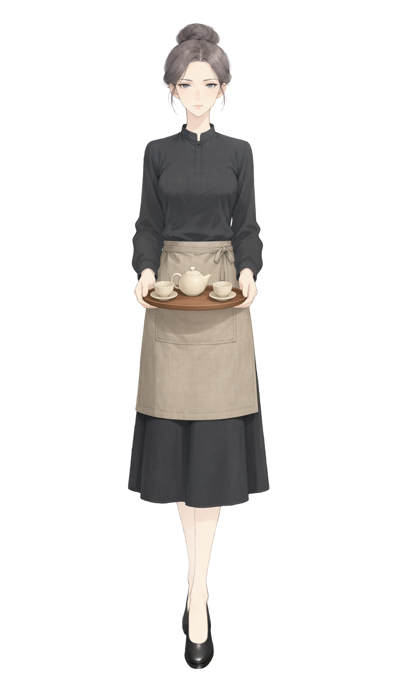
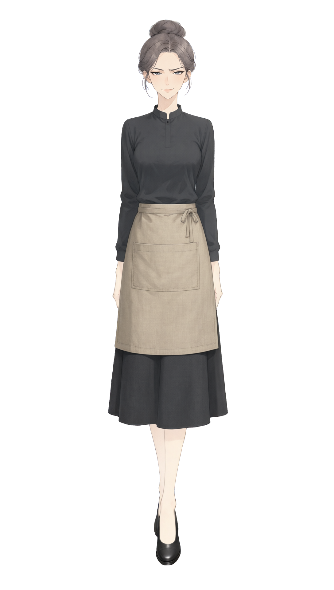
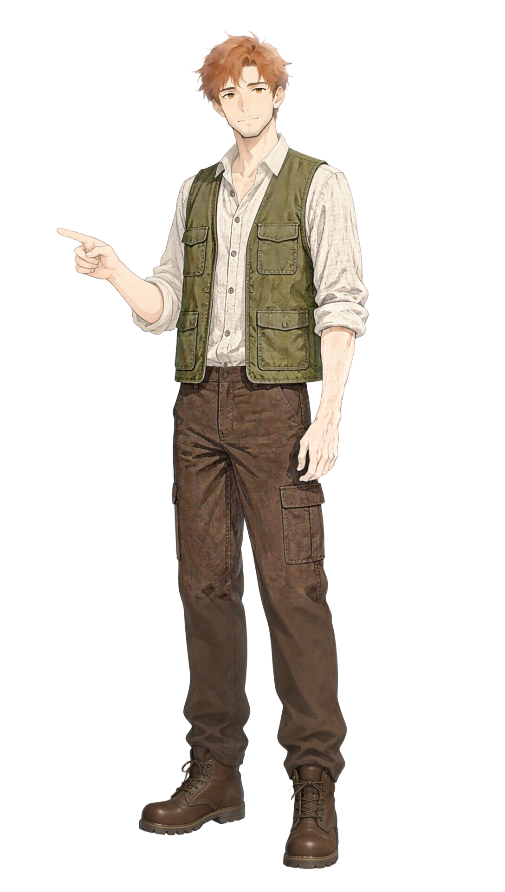
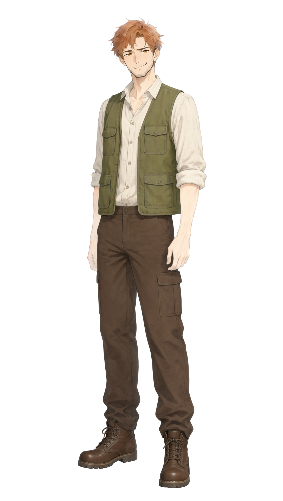
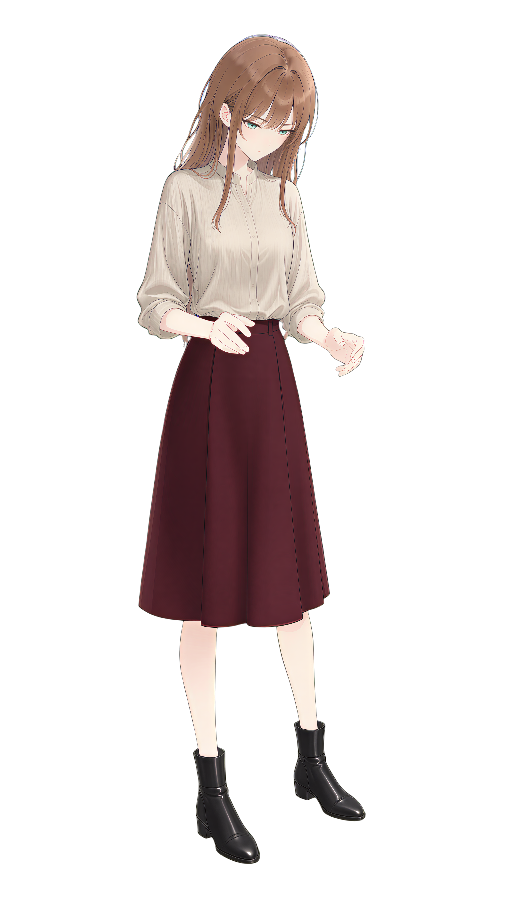
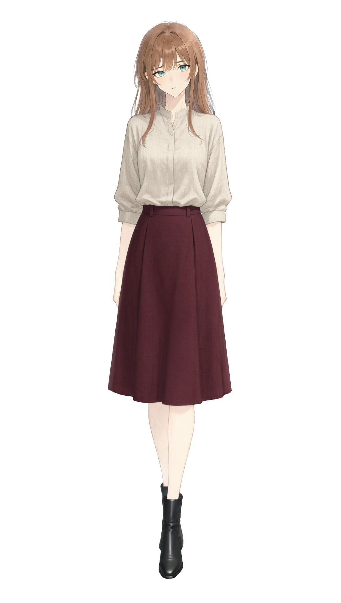
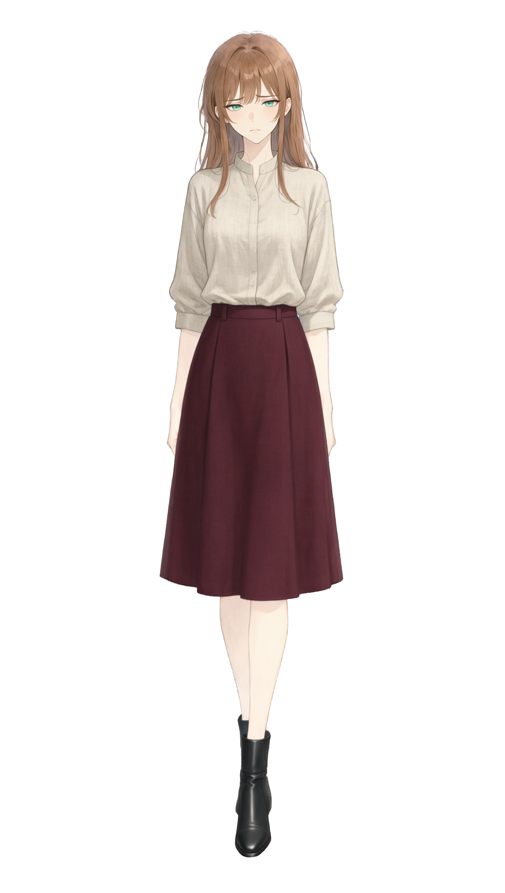
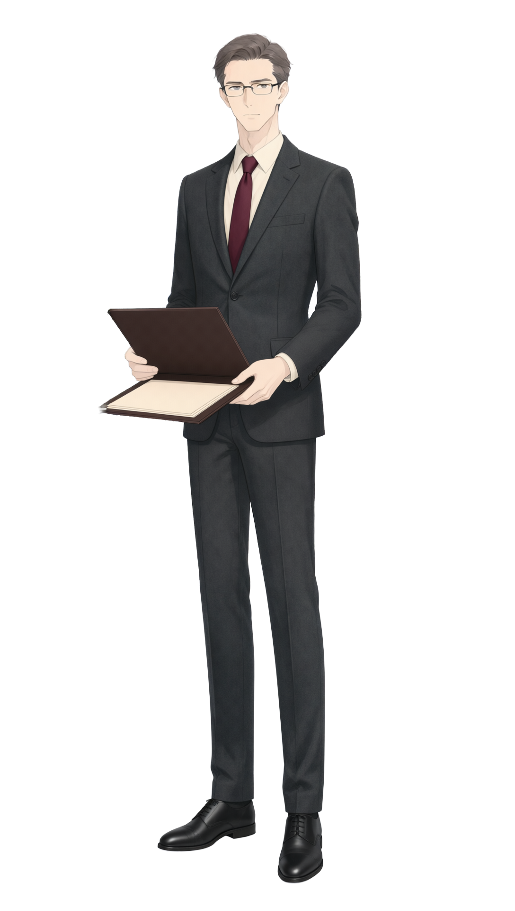
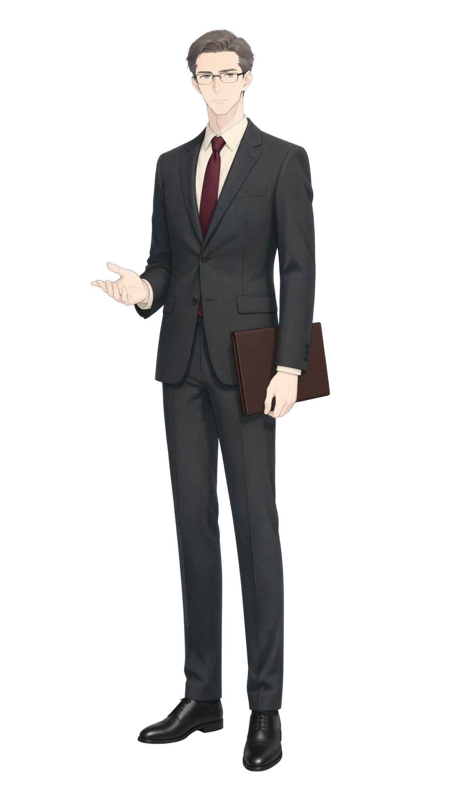
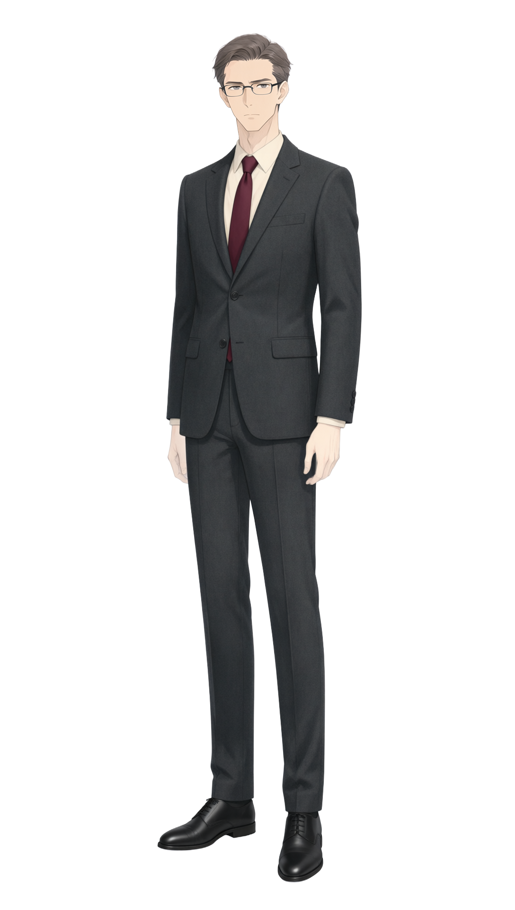

# VN-ART-01 — Approved-reference contact sheet (NOT production candidates)

> **Owner-approved staging reuse supersedes portrait generation (2026-11-17).** This is retained as historical evidence of the **seven originally missing exact variants and their 43 cue appearances**, not an active request to generate them. GFX-05-08 / VN-ART-REUSE-01 now re-stages those cues with seven *existing* accepted catalog entries (including default `investigate_small`, not non-default `investigate_wide`). See [the substitution decision and expressive compromises](../changes/GFX-05-08-chapters-ii-iii-portrait-reuse.md). The 0/7-new-images and BLOCKED labels below describe the **original exact-variant art proposal only**; the updated readiness manifest should report zero missing accepted portraits. Scene/runtime approval and device review remain separate.

**Baseline:** `main@ddcc8a646ffbfa60dcfea43849a592bfdddd9f24` · **Status:** 0/7 new portrait candidates produced; **0/43 cue appearances unblocked**. This sheet is a review aid using **existing, accepted images only**. It is **not** a side-by-side evaluation of new candidates, because no new candidates are available. The missing column is intentionally marked **BLOCKED** rather than displaying a copied neutral frame as a fake finished variant.

Existing accepted catalog: `data/raven/production/vn_character_catalog.json` (62 images, approval 2026-11-02). Readiness authority: `data/raven/production/vn_chapters_ii_iii_readiness.json` (eight scenes, 96 lines in each of RU/BE/EN).

| Priority / missing combination | Approved **pose & costume** | Approved **emotion / identity** | Candidate and evidence |
|---|---|---|---|
| 1. **ADA** `offer_tray/dry_amused` 6 cue appearances |  `RM-VN-ADA-OFFER-TRAY` |  `RM-VN-ADA-BASE-DRY-AMUSED` | **BLOCKED — no candidate image** Reserved path: `assets/raven/characters/ada/offer_tray_dry_amused.webp` Not imported, not approved |
| 2. **ROWAN** `point_route/wry` 7 cue appearances |  `RM-VN-ROWAN-POINT-ROUTE` |  `RM-VN-ROWAN-BASE-WRY` | **BLOCKED — no candidate image** Reserved path: `assets/raven/characters/rowan/point_route_wry.webp` Not imported, not approved |
| 3. **EVELYN** `investigate/curious` 10 cue appearances |  `RM-VN-EVELYN-INVESTIGATE-WIDE` |  `RM-VN-EVELYN-BASE-CURIOUS` | **BLOCKED — no candidate image** Reserved path: `assets/raven/characters/evelyn/investigate_curious.webp` Not imported, not approved |
| 4. **EVELYN** `investigate/worried` 10 cue appearances |  `RM-VN-EVELYN-INVESTIGATE-WIDE` |  `RM-VN-EVELYN-BASE-WORRIED` | **BLOCKED — no candidate image** Reserved path: `assets/raven/characters/evelyn/investigate_worried.webp` Not imported, not approved |
| 5. **LUCAS** `folder_present/professional` 2 cue appearances |  `RM-VN-LUCAS-FOLDER-PRESENT` |  `RM-VN-LUCAS-BASE-PROFESSIONAL` | **BLOCKED — no candidate image** Reserved path: `assets/raven/characters/lucas/folder_present_professional.webp` Not imported, not approved |
| 6. **LUCAS** `explain/professional` 3 cue appearances |  `RM-VN-LUCAS-EXPLAIN` |  `RM-VN-LUCAS-BASE-PROFESSIONAL` | **BLOCKED — no candidate image** Reserved path: `assets/raven/characters/lucas/explain_professional.webp` Not imported, not approved |
| 7. **LUCAS** `explain/serious` 5 cue appearances |  `RM-VN-LUCAS-EXPLAIN` |  `RM-VN-LUCAS-BASE-SERIOUS` | **BLOCKED — no candidate image** Reserved path: `assets/raven/characters/lucas/explain_serious.webp` Not imported, not approved |

## Reproducible reference anchors

Both files in every row have `status: accepted` and source provenance recorded in the existing catalog. Their encoded file content and Git blob SHA remain unchanged. Use only these as edit/identity anchors; do not silently reuse them as a new exact pose × emotion. The approved expression comes from a **different pose** and thus requires an actual facial-performance edit of the pose frame.

| Required variant | Pose reference SHA-256 | Emotion reference SHA-256 | Pose canvas | Source constraints |
|---|---|---|---|---|
| `ada/offer_tray_dry_amused` | `c42f15219ca75d3f2ef4d814106fd41566706ca9a0279ddd3995cc2e016c8ea8` | `74c336e1f7693ac9e4d112539bc7009e76f5bc6e35d9adeb1de1666c402d560b` | 1088×1920 RGBA | Pose workflow SHA recorded |
| `rowan/point_route_wry` | `6674591c7115bbf5625d98477b7ade21326e620f77453861a844e5a400e77c85` | `4c47c581538cf06e178800cf45dbca7df21aa2c3973f379a3ada58f41469906b` | 1088×1920 RGBA | Pose workflow SHA recorded |
| `evelyn/investigate_curious` | `22cd2538ec0fed55643ca95ddee1d4fe5e236b476035aa3371564e7bd70b8ec6` | `3f676185259c68c06bd3bcb3eb47674262562e19e5cad7a7a60d9370e81bee69` | 2048×3614 RGBA | Pose workflow SHA recorded |
| `evelyn/investigate_worried` | `22cd2538ec0fed55643ca95ddee1d4fe5e236b476035aa3371564e7bd70b8ec6` | `37b08ba8768178d8f8ab1fca2f352d74e5424f51dbf09daa352374f6b004cbfb` | 2048×3614 RGBA | Pose workflow SHA recorded |
| `lucas/folder_present_professional` | `97964528d443e9e803ad8db14d57f7c1b9d153b28e336b617c924b77ac046a01` | `ba57ef4fb81e93ec0d25efab3183d3a16796479ca1a2459879da4642a35ab01a` | 1088×1920 RGBA | Pose workflow SHA recorded |
| `lucas/explain_professional` | `fd2ba0eb05f5a64e3fda642a63b4956b59a4b69ce4cc8835575ca1401c0b3151` | `ba57ef4fb81e93ec0d25efab3183d3a16796479ca1a2459879da4642a35ab01a` | 1088×1920 RGBA | Pose workflow SHA recorded |
| `lucas/explain_serious` | `fd2ba0eb05f5a64e3fda642a63b4956b59a4b69ce4cc8835575ca1401c0b3151` | `3a6f6df432f5cc94ff887f2a99be6b3b7c4dc8b6d73db58f3d700b6b4d215117` | 1088×1920 RGBA | Pose workflow SHA recorded |

## Exact missing cue coverage (from the review-only manifest)

| Missing accepted pose × emotion | Canonical scenes and impacted line IDs | Occurrences |
|---|---|---:|
| `RM-CHAR-ADA/offer_tray/dry_amused` | `RM-BEAT-02-01`: `RM-BEAT-02-01-L002`, `RM-BEAT-02-01-L004`, `RM-BEAT-02-01-L006`, `RM-BEAT-02-01-L008`, `RM-BEAT-02-01-L010`, `RM-BEAT-02-01-L011` | 6 |
| `RM-CHAR-ROWAN/point_route/wry` | `RM-BEAT-02-02`: `RM-BEAT-02-02-L001`, `RM-BEAT-02-02-L004`, `RM-BEAT-02-02-L006`, `RM-BEAT-02-02-L008`, `RM-BEAT-02-02-L010`, `RM-BEAT-02-02-L011`, `RM-BEAT-02-02-L013` | 7 |
| `RM-CHAR-EVELYN/investigate/curious` | `RM-BEAT-02-03`: `RM-BEAT-02-03-L001`, `RM-BEAT-02-03-L003`, `RM-BEAT-02-03-L005`, `RM-BEAT-02-03-L006`, `RM-BEAT-02-03-L008`, `RM-BEAT-02-03-L010`, `RM-BEAT-02-03-L012`, `RM-BEAT-02-03-L014`, `RM-BEAT-02-03-L016`, `RM-BEAT-02-03-L018` | 10 |
| `RM-CHAR-EVELYN/investigate/worried` | `RM-BEAT-03-03`: `RM-BEAT-03-03-L001`, `RM-BEAT-03-03-L003`, `RM-BEAT-03-03-L005`, `RM-BEAT-03-03-L007`, `RM-BEAT-03-03-L009` `RM-BEAT-03-04`: `RM-BEAT-03-04-L001`, `RM-BEAT-03-04-L003`, `RM-BEAT-03-04-L005`, `RM-BEAT-03-04-L007`, `RM-BEAT-03-04-L009` | 10 |
| `RM-CHAR-LUCAS/folder_present/professional` | `RM-BEAT-03-01`: `RM-BEAT-03-01-L001`, `RM-BEAT-03-01-L005` | 2 |
| `RM-CHAR-LUCAS/explain/professional` | `RM-BEAT-03-02`: `RM-BEAT-03-02-L007`, `RM-BEAT-03-02-L009`, `RM-BEAT-03-02-L012` | 3 |
| `RM-CHAR-LUCAS/explain/serious` | `RM-BEAT-03-03`: `RM-BEAT-03-03-L002`, `RM-BEAT-03-03-L004`, `RM-BEAT-03-03-L006`, `RM-BEAT-03-03-L008`, `RM-BEAT-03-03-L010` | 5 |
| **Total** | **7 unique combinations in 7 of the 8 reviewed scenes; 43 line appearances. `RM-BEAT-02-04` has zero missing portrait cues.** | **43** |

**Meaning of coverage:** these are blocked exact image selections, **not** 43 missing dialogue lines. The three-localization cue contract is keyed to stable line IDs; no locale dialogue, cue, scene gate or save state was edited in this PR.

## Per-asset production and manual-review guide

### 1. `ada/offer_tray_dry_amused` (6 cues)

Preserve the tray, two teacups, teapot, apron, hand contact, and full-length silhouette; transfer only the restrained dry smile / asymmetric brows; avoid moving the serving tray.

- **Exact candidate target (currently absent):** `res://assets/raven/characters/ada/offer_tray_dry_amused.webp`.
- **Edit base:** `res://assets/raven/characters/ada/offer_tray.webp` (accepted pose `offer_tray/neutral`; 1088×1920).
- **Identity/expression guide:** `res://assets/raven/characters/ada/base_dry_amused.webp` (accepted `composed/dry_amused`).
- **Blocker:** No verified image-edit/generation pipeline or candidate pixels were produced in this session; face transfer is untested, and the inherited neutral pose must not be registered as the requested expression.

### 2. `rowan/point_route_wry` (7 cues)

Preserve pointing arm and finger direction, gardening outfit, hair and anatomy; subtle crooked smile and wry brows, not a broad grin.

- **Exact candidate target (currently absent):** `res://assets/raven/characters/rowan/point_route_wry.webp`.
- **Edit base:** `res://assets/raven/characters/rowan/point_route.webp` (accepted pose `point_route/neutral`; 1088×1920).
- **Identity/expression guide:** `res://assets/raven/characters/rowan/base_wry.webp` (accepted `work_ready/wry`).
- **Blocker:** No verified image-edit/generation pipeline or candidate pixels were produced in this session; face transfer is untested, and the inherited neutral pose must not be registered as the requested expression.

### 3. `evelyn/investigate_curious` (10 cues)

Preserve approved investigate pose and costume, hands and prop-free silhouette; alert curious eyes, mildly raised brows, natural mouth.

- **Exact candidate target (currently absent):** `res://assets/raven/characters/evelyn/investigate_curious.webp`.
- **Edit base:** `res://assets/raven/characters/evelyn/investigate_wide.webp` (accepted pose `investigate/neutral`; 2048×3614).
- **Identity/expression guide:** `res://assets/raven/characters/evelyn/base_curious.webp` (accepted `relaxed/curious`).
- **Blocker:** No verified image-edit/generation pipeline or candidate pixels were produced in this session; face transfer is untested, and the inherited neutral pose must not be registered as the requested expression.

### 4. `evelyn/investigate_worried` (10 cues)

Preserve same investigate silhouette to allow expression-only continuity; worried brows and mouth, without changing face proportions or outfit.

- **Exact candidate target (currently absent):** `res://assets/raven/characters/evelyn/investigate_worried.webp`.
- **Edit base:** `res://assets/raven/characters/evelyn/investigate_wide.webp` (accepted pose `investigate/neutral`; 2048×3614).
- **Identity/expression guide:** `res://assets/raven/characters/evelyn/base_worried.webp` (accepted `relaxed/worried`).
- **Blocker:** No verified image-edit/generation pipeline or candidate pixels were produced in this session; face transfer is untested, and the inherited neutral pose must not be registered as the requested expression.

### 5. `lucas/folder_present_professional` (2 cues)

Preserve folder, fingers, glasses, suit and framing; neutral professional notary expression with correct eye alignment.

- **Exact candidate target (currently absent):** `res://assets/raven/characters/lucas/folder_present_professional.webp`.
- **Edit base:** `res://assets/raven/characters/lucas/folder_present.webp` (accepted pose `folder_present/neutral`; 1088×1920).
- **Identity/expression guide:** `res://assets/raven/characters/lucas/base_professional.webp` (accepted `formal/professional`).
- **Blocker:** No verified image-edit/generation pipeline or candidate pixels were produced in this session; face transfer is untested, and the inherited neutral pose must not be registered as the requested expression.

### 6. `lucas/explain_professional` (3 cues)

Preserve explain gesture, suit and glasses; attentive professional expression, no hand deformation.

- **Exact candidate target (currently absent):** `res://assets/raven/characters/lucas/explain_professional.webp`.
- **Edit base:** `res://assets/raven/characters/lucas/explain.webp` (accepted pose `explain/neutral`; 1088×1920).
- **Identity/expression guide:** `res://assets/raven/characters/lucas/base_professional.webp` (accepted `formal/professional`).
- **Blocker:** No verified image-edit/generation pipeline or candidate pixels were produced in this session; face transfer is untested, and the inherited neutral pose must not be registered as the requested expression.

### 7. `lucas/explain_serious` (5 cues)

Preserve explain gesture, suit and glasses; serious focused brows and mouth; not threatening or supernatural.

- **Exact candidate target (currently absent):** `res://assets/raven/characters/lucas/explain_serious.webp`.
- **Edit base:** `res://assets/raven/characters/lucas/explain.webp` (accepted pose `explain/neutral`; 1088×1920).
- **Identity/expression guide:** `res://assets/raven/characters/lucas/base_serious.webp` (accepted `formal/serious`).
- **Blocker:** No verified image-edit/generation pipeline or candidate pixels were produced in this session; face transfer is untested, and the inherited neutral pose must not be registered as the requested expression.

## Acceptance and technical gates after real images exist

1. **Pixels:** match pose-source canvas dimensions and RGBA transparency, no clipped hands/feet/hair, correct pose/face/costume/props; validate alpha and run lossless WebP export with SHA-256 and a linked origin/workflow or documented `null` if unrecoverable.
2. **Studio and engine:** import in Godot 4.7.2; show full-size alpha preview and an in-editor VN Studio shot (including the **Hall Tea / `RM-BEAT-02-01`** left Evelyn and right Ada); confirm no overlap or crop in two- and three-character layouts and on mobile. Pixel/engine tests are **NOT RUN** here.
3. **Cue / locale:** verify the seven exact pairs resolve for all 43 line IDs and RU/BE/EN, without synthetic fallback or stage/gate edits. Catalog registration must reference the **actual produced asset** and remain pending until owner approval.
4. **Ownership:** owner reviews and approves **each of seven** new images individually. Only then supply Agent D the accepted registry patch. No auto-merge, no new story IDs, no changes to the 62 previously approved images.

## Rights and provenance

All pose/expression anchors are existing public Raven Manor files with original source paths, source/workflow SHA metadata in `vn_character_catalog.json`; no UPDS private artwork is used. Rights of any future new generative model, source images, and edited export must be explicitly recorded for each new candidate. The reference sheet adds links only and does not duplicate or relicense any accepted image.
